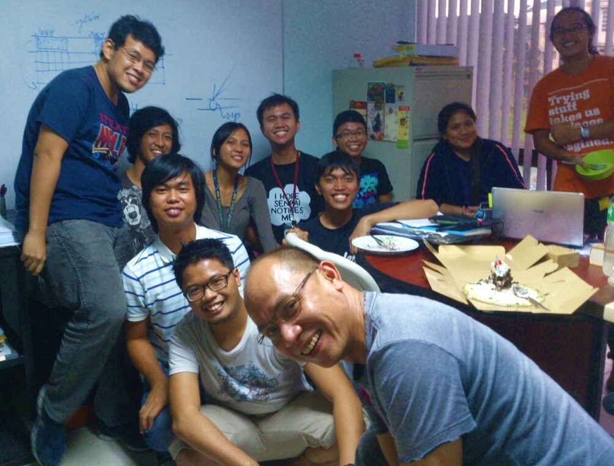
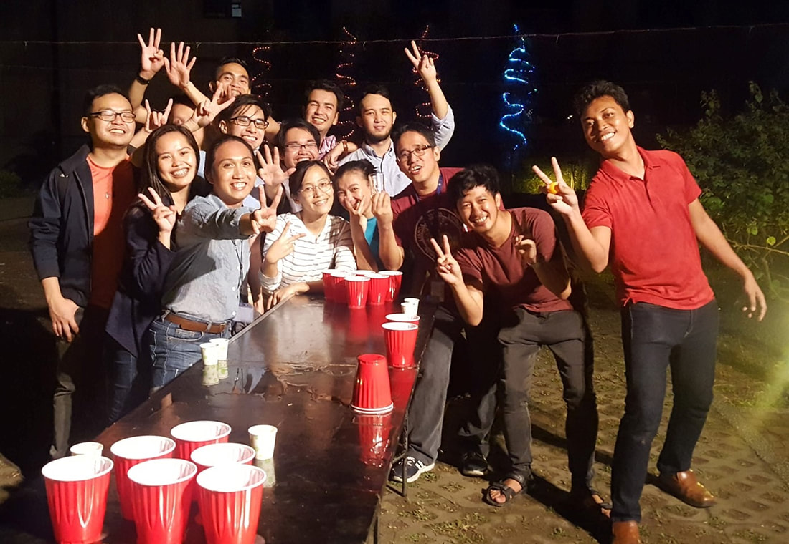
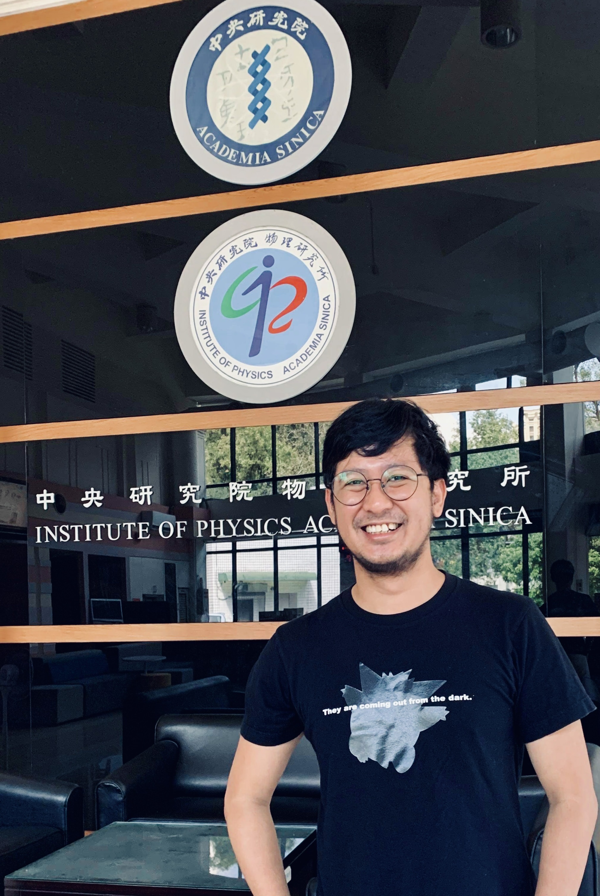
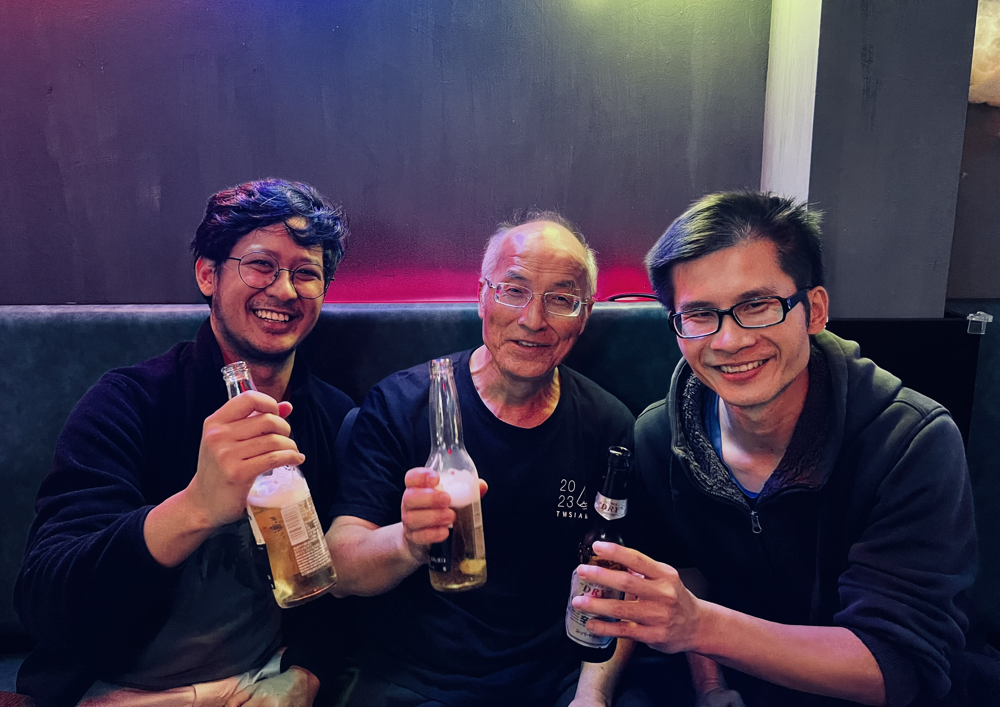
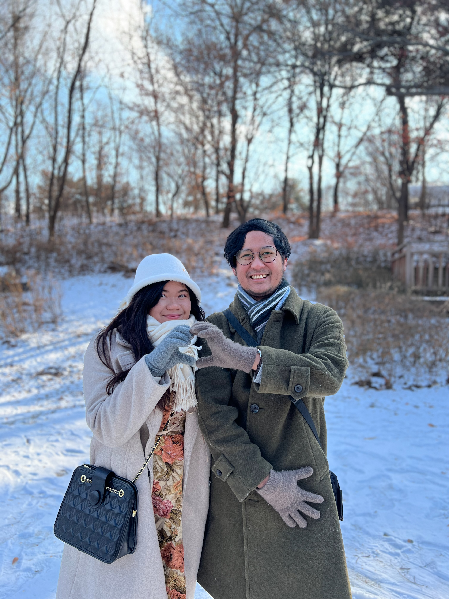
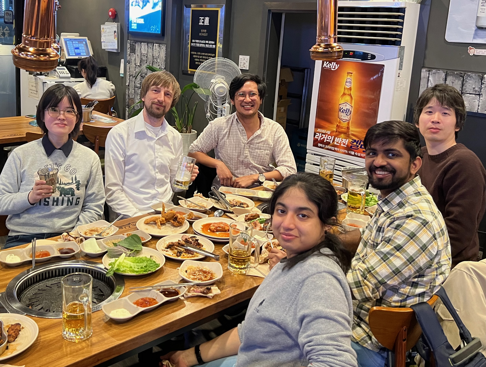

### Profile

I am a senior researcher at the [Max Planck Institute for Gravitational Physics (Albert Einstein Institute)](https://www.aei.mpg.de/obs-rel-cos) in Hannover, working on pulsar timing arrays, gravitational waves, and cosmology. I trained in physics at the University of the Philippines (BS 2015, MS 2017, PhD 2020), where I studied gravity beyond general relativity, and I have since worked in Taiwan, Korea, and Germany.

### Origin

I hail from [Calamba, Philippines](https://en.wikipedia.org/wiki/Calamba,_Laguna). In this city, rich in history and beauty, I completed my high school and part-seminary education. Afterwards, I went to physics.

### Academic Journey

I underwent rigorous scientific training (BS 2015; MS 2017; PhD 2020) at the [National Institute of Physics](http://nip.upd.edu.ph/) at the [University of the Philippines](https://upd.edu.ph/). My academic journey has been featured in various local news; see my favorite picks by [FlipScience](https://www.flipscience.ph/news/features-news/features/reginald-bernardo-gravitational-physicist), [ABS-CBN News](https://news.abs-cbn.com/spotlight/06/07/20/beyond-einstein-a-young-pinoy-physicist-shines-light-on-black-holes-dark-energy), and [Davao Today](http://davaotoday.com/main/economy/education/a-hope-for-science-community-as-up-alum-becomes-phls-first-gravitational-physicist).

In college and grad school, I had the privilege of learning under the mentorship of two distinguished physicists, [Perry Esguerra](http://nip.upd.edu.ph/profiles/jose-perico-esguerra/) and [Ian Vega](https://ianvega.wixsite.com/ianvega/about), both of whom greatly influenced my research trajectory. My association with the [Gravity Group](https://gravity-nip.github.io/) further enriched my academic pursuits.

Here are some memorable moments captured during my academic journey:

(Physics undergrads enjoying cake)

  

(Grad students playing with projectiles)

  

After completing my PhD, I embarked on my first postdoc at the [Institute of Physics, Academia Sinica](https://www.phys.sinica.edu.tw/index.php) in Taiwan, where I continued my exploration in theoretical cosmology and gravitational physics. There I worked with [Kin-Wang Ng](https://inspirehep.net/authors/995762), and it was with Kin that I found my way into gravitational waves through pulsar timing, a direction that has shaped everything since.

(At ASIoP)

  

(ASIoP Gravity-Cosmology; center <a href="https://inspirehep.net/authors/995762">Kin-Wang Ng</a>, right <a href="https://www.cheyuchen.com">Che-Yu Chen</a>)

  

Then, I joined the Observational Cosmology Junior Research Group as a postdoc at the [Asia Pacific Center for Theoretical Physics](https://www.apctp.org/) in Korea. I spent two years in Taiwan and a year and a half (freezing!) in Korea---exploring gravity, cosmology, and astrophysics. In Korea, I collaborated with Stephen Appleby, the group's leader, bringing my expertise in gravitational physics to observational cosmology while drawing on his experience in connecting theoretical models to what the data can actually support.

(Seoul Forest with my soulmate; <a href="http://twitter.com/venus_gaela">Venus Marie Gaela</a>)

  

(APCTP Cosmology Fellowship; left-to-right, Lu Yin, Stephen Appleby, Toshali Mitra, Akhil Antony, Motonari Tonegawa)

  

Now, as a researcher at the [Max Planck Institute for Gravitational Physics (Albert Einstein Institute)](https://www.aei.mpg.de/obs-rel-cos) in Hannover, Germany, I turn my attention to pulsar timing arrays and gravitational waves to look into physics on scales inaccessible to terrestrial and space-based laser interferometric GW detectors. My supervisor is Bruce Allen, and our collaboration brings together my background in gravitational physics and cosmology with his deep experience in gravitational wave research, particularly in understanding what constitutes a genuine signal—and what does not.

### Beyond Science

Outside of science, I find joy in playing chess and basketball, trekking through nature's wonders, and engaging in profound conversations over a drink. My love for cinema extends to favorites such as the gripping masterpiece 'Whiplash', the thought-provoking TV series 'Mr. Robot' (shoutout to fellow fans!), the timeless sitcom 'The Office US', and the captivating anime 'Fullmetal Alchemist: Brotherhood'.