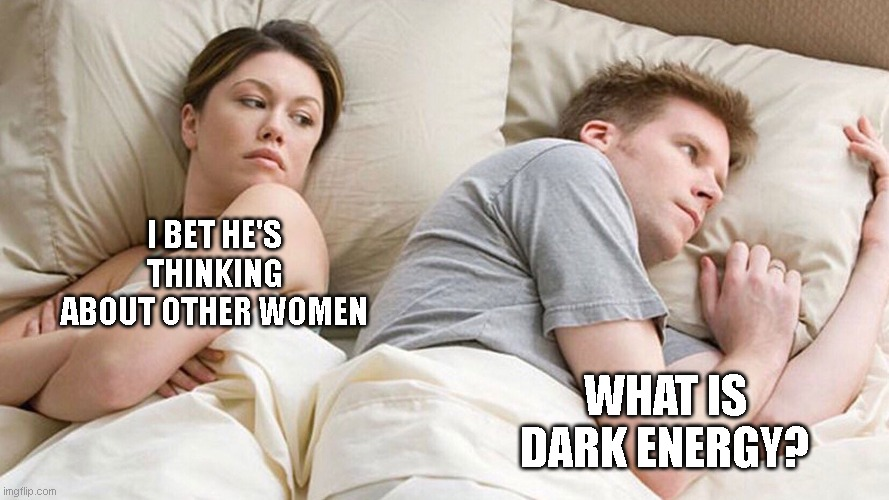

> "Pick a flower on Earth and you move the farthest star." - PD

At A Glance



[Research](./research) &middot; [CV](./mycv/main.pdf) &middot; [GitHub](https://github.com/reggiebernardo) &middot; [INSPIRE](https://inspirehep.net/authors/1758391) &middot; [ORCID](https://orcid.org/0000-0001-8589-6851) &middot; [Google Scholar](https://scholar.google.com/citations?user=qoDKcvQAAAAJ&hl=en) &middot; [Email](mailto:reginaldchristianbernardo@gmail.com)

---

Hello, Reggie here! I'm a [cosmologist](https://en.wikipedia.org/wiki/Physical_cosmology). In this website, I share my investigations and thoughts on developments in the field -- at the moment my interests have aligned with pulsar timing and pulsar timing arrays. Two questions that I chase after are

> What is the origin of the nanohertz gravitational wave signal?

and

> How far could we learn about neutron stars' anatomy with data?

Delve into my [research](./research) and [codes](https://github.com/reggiebernardo) to learn more about my interests. Feel free to [reach out](mailto:reginaldchristianbernardo@gmail.com) with any questions or comments.

Me as meme (concepted with VMG)

 
Reading starter pack for a good time:  
[Four golden lessons](https://www.nature.com/articles/426389a)  
[Three ways to turn the page after your first paper rejection](https://www.nature.com/articles/d41586-020-01166-2)  
[How to (seriously) read a scientific paper](https://www.sciencemag.org/careers/2016/03/how-seriously-read-scientific-paper)  
[Physics … is for girls?](https://physicstoday.scitation.org/doi/full/10.1063/PT.3.5061)  

Fun guesting in the Philippines' best Science Podcast:  
<iframe style="border-radius:12px" src="https://open.spotify.com/embed/episode/6PLqA3RoWQLmqGGH4yRP8C?utm_source=generator&theme=0" width="100%" height="152" frameBorder="0" allowfullscreen="" allow="autoplay; clipboard-write; encrypted-media; fullscreen; picture-in-picture" loading="lazy"></iframe>